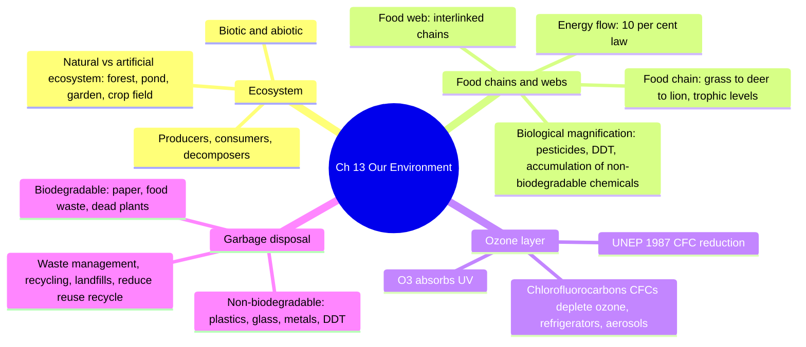

# Class X · Ch 13 — Our Environment

*Environment* · हमारा पर्यावरण

## Ecosystem

- Biotic and abiotic
- Producers, consumers, decomposers
- Natural vs artificial ecosystem: forest, pond, garden, crop field

## Food chains and webs

- Food chain: grass to deer to lion; trophic levels
- Food web: interlinked chains
- Energy flow: 10 per cent law
- Biological magnification: pesticides, DDT; accumulation of non-biodegradable chemicals

## Ozone layer

- O3 absorbs UV
- Chlorofluorocarbons (CFCs) deplete ozone; refrigerators, aerosols
- UNEP 1987 CFC reduction

## Garbage disposal

- Biodegradable: paper, food waste, dead plants
- Non-biodegradable: plastics, glass, metals, DDT
- Waste management; recycling; landfills; reduce reuse recycle

## Visual lessons in the app

- Energy flow & 10% law
- Food web
- Ozone layer depletion
- Biodegradable vs non-biodegradable
