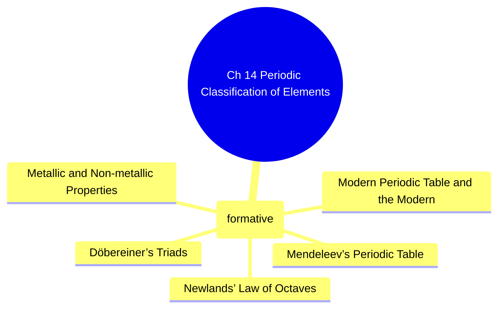

# Class X · Ch 14 — Periodic Classification of Elements

*Unit I · Chemical Substances – Nature and Behaviour (25 marks)* · तत्वों का आवर्त वर्गीकरण

## Periodic Classification of Elements _(formative-only in 2026–27; not in year-end exam)_

- Döbereiner’s Triads
- Newlands’ Law of Octaves
- Mendeleev’s Periodic Table
- Modern Periodic Table and the Modern
- Metallic and Non-metallic Properties

## Visual lessons in the app

- Döbereiner’s triads & Newlands’ octaves
- Mendeleev’s periodic table
- Modern periodic table & properties
